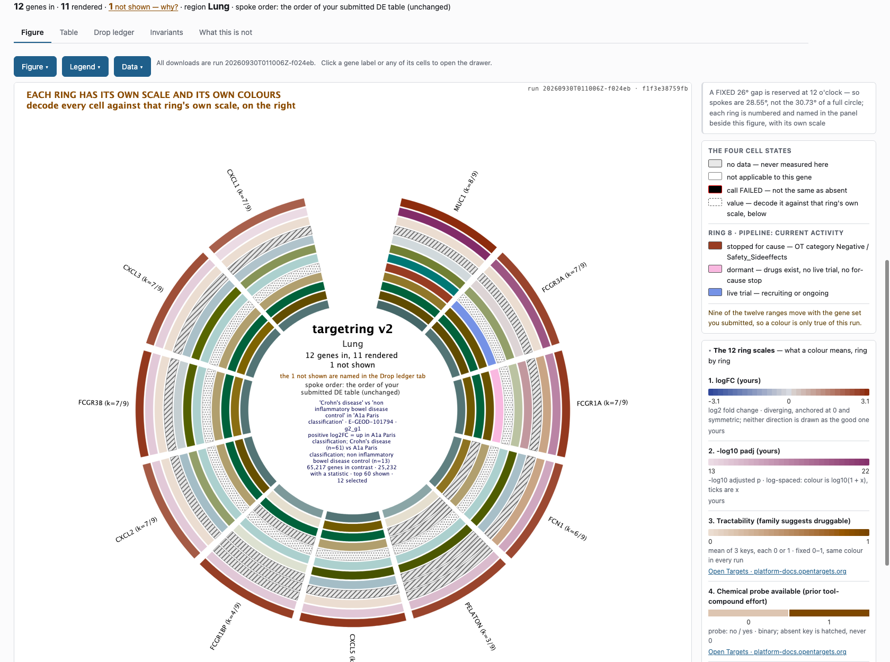
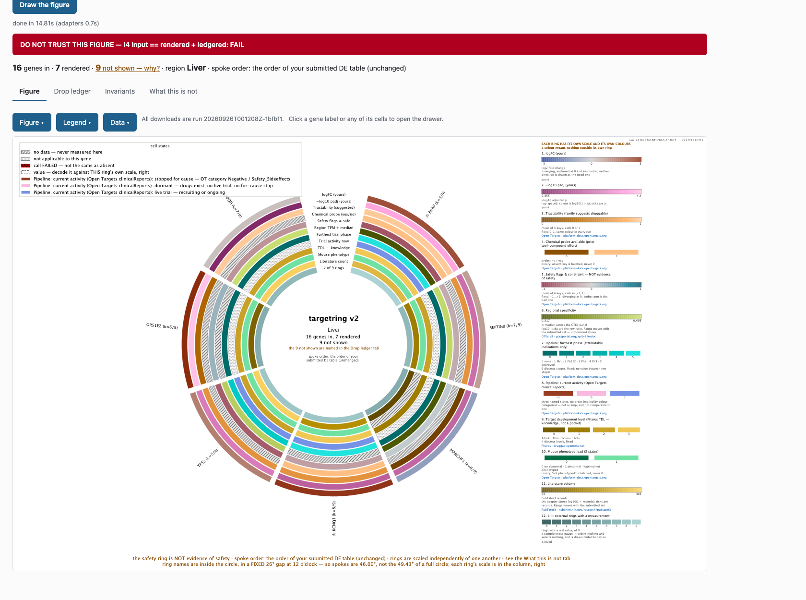
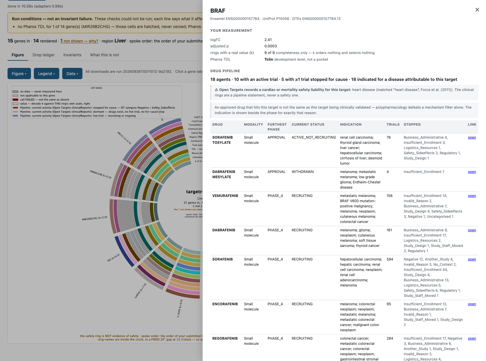
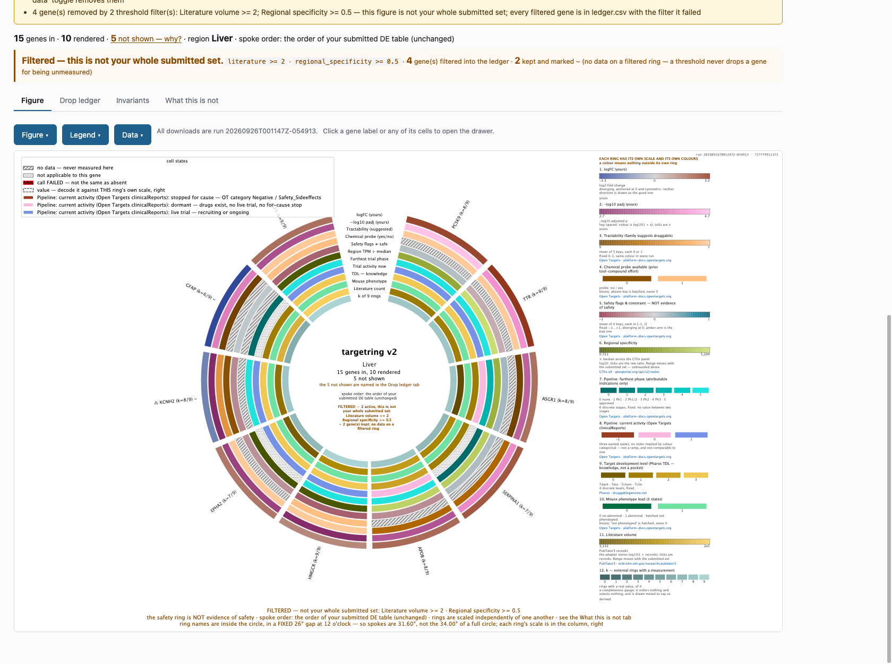

# targetring

**A differential-expression result in, a Circos evidence figure out — built so
that it cannot quietly draw something wrong.**

Type a disease. The app finds a public expression study for it, picks a
comparison of affected against unaffected people, and draws what is known about
each gene that differs: druggability, safety, tissue specificity, drug pipeline,
literature, mouse phenotype. Every choice it made is shown and can be changed.
Click a gene for its full drug pipeline and the trials behind it.



*Crohn's disease. The app chose contrast `E-GEOD-101794 g2_g1` (n=61 vs 13),
took the top 60 genes by adjusted p, and drew the 12 selected. The centre
states the contrast, the sign convention and the selection rule. Each ring
has its own scale, in the column on the right.*

## Try it

**[The tool, on one worked example →](https://hotsoupisgood.github.io/TargetRing/)**

That page is the app itself, opened in the Crohn's run above: the circle is
clickable, every gene opens its drawer with its verdict and its evidence
summary, and the drop ledger and the invariant results are that run's own. It
serves finished artefacts and nothing else — it makes no request and no model
call, and the controls that would start an analysis answer with the refusal
that says so.

**What the demo run's model spend came to, measured 2026-10-18: $1.35 across
five separate accounts** — baked evidence summaries $1.00, the contrast chooser
$0.24, the per-gene phenotype summaries $0.06, the region chooser $0.05, and
nothing at all on the triage account, which is not built. Those numbers are on
the demo's **Paid calls** tab and in its `manifest.json`, each carrying the date
it was measured: model prices change, so an undated total would read as current
forever. No paid call is on the render path — the figure draws without a key.

**[The flowchart: disease name to GO / NO-GO, step by step →](https://hotsoupisgood.github.io/TargetRing/flow/)**

## Why it exists

This figure used to be built by hand, for a target-prioritisation meeting,
from six browser tabs and a spreadsheet. It took an afternoon per gene set, it
was never quite reproducible, and the hardest part was not the data — it was
being sure that an empty cell meant "nobody has measured this" and not "the
lookup silently failed". targetring automates the figure, and it was designed
around that one hard part.

## The one rule

> **A plausible wrong figure is the worst possible output.** Worse than a
> crash, worse than an empty ring, worse than a slow page.

Everything in the build is downstream of that. Concretely:

- **Missing is never low.** Every cell is one of four states — a value,
  `no_data`, `not_applicable`, `failed` — and the three non-values are drawn
  distinctly (hatched, stippled, red) and never filled, averaged or zeroed.
  Each gene carries *k*, how many rings it actually has, printed on the figure.
- **Join by identifier, never by position.** Open Targets drops genes it
  cannot find and returns HTTP 200 with a shorter array, which shifts every
  downstream cell by one. Every adapter builds `{id: record}` and looks up by
  the id it asked for.
- **Every gene is accounted for.** `input == rendered + ledgered` is asserted
  in code on every run. A gene that leaves the figure is named in the drop
  ledger with the reason. Counts are stamped on the figure.
- **The query must come back unchanged.** Europe PMC echoes the query; it is
  asserted byte-identical. One unbalanced quote once inflated a hit count 12×
  behind an HTTP 200.
- **When a check fails, the figure says so.** Seven invariants run on every
  render. A failure puts a banner on the figure itself — not a log line, not a
  toast — so a screenshot carries the warning.



*A deliberately broken input. The figure renders, and it says not to trust it.*

## What is on the figure

Twelve rings, nine from external sources. No ranking, no score, no weights:
the spoke order is the order of the submitted table, stated on the figure, and
the rings are evidence for a reader to weigh, not a verdict.

| ring | what it is | source |
|---|---|---|
| logFC, −log10 adj p | the submitted measurement | yours |
| Tractability | family suggests druggable (3 keys) | Open Targets `prioritisation` |
| Chemical probe | a high-quality probe exists | Open Targets |
| Safety flags | safety event, essentiality, constraint, cancer driver | Open Targets |
| Regional specificity | region TPM ÷ median across 54 tissues | GTEx v8 |
| Furthest trial phase | for indications with genetic evidence linking them to this target | Open Targets |
| Trial activity now | live / dormant / stopped-for-cause | Open Targets clinical reports |
| TDL | Tdark → Tclin, how much is known | Pharos |
| Mouse phenotype | a lead, not a verdict; labelled "unverified" | Open Targets `mousePhenotypes` |
| Literature volume | mentions resolved to a gene id, not text-matched | PubTator3 |
| k | rings with a real value, of 9 | derived |

Two of those rows hide real decisions. *Furthest phase* requires genetic
evidence linking the drug's indication to the target, because an approved
multi-kinase inhibitor would otherwise set a ring to "approved" for every
kinase it happens to hit. *Trial activity* is three named states rather than
an ordinal, because only ~13% of trial terminations say anything about the
target — measured live over 1,433 BRAF reports — and a "discontinued" marker
would mislead on seven of every eight.



*The drawer. 18 agents, each with its phase, status, indication and
categorised stop reasons. The safety liability is stated above the pipeline
because the clinical rings are a pipeline statement, never a safety one.*

## The GO / NO-GO line

Separate from the rings, and from a different author. The rings are evidence
and carry no verdict. The verdict line in a gene's highlight box and drawer is
**Puck's explicit rule** (2026-10-18: "we need the gene to be expressed, and
also misregulated in the study, and have a strong phenotype in a study"),
evaluated deterministically by `targetring/recommend.py` from the numbers the
drawer already shows, and baked into the drawer file beside them.

Rule: **expressed AND dysregulated AND phenotype.** Each criterion is met, not
met, or no data, with its value printed:

| criterion | met when | default |
|---|---|---|
| expressed | GTEx median TPM in the run's region ≥ `RECOMMEND_MIN_TPM`; with no GTEx number, Open Targets `tissueDistribution` > 0 | 1 TPM |
| dysregulated in the study | \|logFC\| ≥ `RECOMMEND_MIN_ABS_LOGFC` and adjusted p ≤ `RECOMMEND_MAX_Q` | 1.0, 0.05 |
| phenotype in a study | mouse-phenotype ring > 0, or ≥ `RECOMMEND_MIN_PHENOTYPES` abnormal mouse terms | 1 |

GO when all three are met; NO-GO when any is not met; INSUFFICIENT DATA when
nothing is unmet but something could not be judged (not met beats no data).
A down-regulated gene gets the one line "a biologic may be preferred". The
thresholds and a hash of the rule travel with every verdict as
`recommendation.rule_version`.

The box is deliberately terse (owner, 2026-10-18: *"make it much less
wordy"*): a verdict pill, a three-word region tag, the three criteria as
met / not met / no data with the bare value, and the rule on one line with its
thresholds in a tooltip. Expression is not spelled out in words — the
tissue-specificity ring on the figure is where that number lives. Druggability
and toxicity say nothing at all: they are not criteria, and a caveat under a
verdict that never read them was advice the reader could not act on. Only a
*severe* safety liability on record gets a line, and it still excludes nothing.

Beside the deterministic phenotype criterion the box prints
**`phenotype (Claude): 0/1`** and one sentence naming the terms it read — a
baked model call (`targetring/phenotype_llm.py`) given the gene's mouse
phenotype terms, its knockout ring and the contrast's disease area, and nothing
else: not the verdict, not the logFC, because a model given the verdict agrees
with the verdict instead of reading the terms. It is a display aid — it never
changes a verdict, it is not in `rule_version`, and `recommend.py` cannot see
it. Baked offline on its own $1 spend account
(`scripts/bake_phenotype_flags.py`); a demo box serves the file and makes no
call.

It is not used to order or filter the figure, and it never touches the drop
ledger. Change a threshold in `config.py` and re-stamp with
`scripts/bake_drawers.py --recommend-only <run_id>`: no request, no model.

## Filters are stated, not silent

Threshold filters can remove genes from the plot. When they have, the figure
says which filters, how many genes, and that it is not the whole submitted
set. A filter never drops a gene for being unmeasured.



## How it was built

**Planned first.** [`PLAN.md`](PLAN.md) is the spec. Before the build, two
external reviews were commissioned against it — a scientific council and a QA
review, in [`docs/reviews/`](docs/reviews/) — and every BLOCKING finding
became a build requirement. Several of the plan's original choices were wrong
against the live sources (a GraphQL field that does not exist, a search
endpoint that returns other genes) and the reviews caught them before any code
did.

**Then built in versions**, each with a report: [`V1`](docs/V1-REPORT.md),
[`V2`](docs/V2-REPORT.md), then a sequence of measured, dated decisions:

- [RNA-seq only](docs/DECISION-RNASEQ-ONLY-2026-10-02.md) — microarray
  contrasts dropped after a probe-mapping investigation showed sign flips.
- [The app chooses a contrast by default](docs/DECISION-AUTOPICK-2026-10-09.md)
  — reversing an earlier refusal, with the reasons, and what must stay true.
- [A public demo, tabled](docs/TABLED-PUBLIC-DEMO-2026-10-09.md) — sized and
  costed, not built.

**With money gated.** Four LLM calls exist — gene triage, a phenotype summary,
a contrast chooser, a region chooser. Each has its own spend cap and counter
in an append-only ledger, reserve-before and commit-after. Each chooses only
from a closed list the app supplied, and the answer is verified against that
list on return. When a model call fails, the rule-based fallback runs and the
figure records *who actually chose*.

**Tested.** 1,418 tests. Several of them scan the executable code for the
thing they forbid — one reads the chooser's method body to assert it combines
nothing into a score.

## Run it

Python 3.13. No API key needed.

```sh
git clone <this repo> targetring && cd targetring
python3 -m venv .venv && .venv/bin/pip install -r requirements.txt
.venv/bin/python -m uvicorn targetring.app:app --host 127.0.0.1 --port 8900
```

Open http://127.0.0.1:8900. Type a disease, or paste a DE table — there is
one at `fixtures/de_realistic.csv` (15 genes, liver). A first run on it takes
about 20 s cold against the live sources; artefacts land in `runs/<id>/` and
upstream payloads are cached in `cache/` so the second run is faster.

The disease picker works out of the box: a copy of the Expression Atlas
contrast index (369 experiments, 1,126 contrasts, built 2026-09-29) is checked
in under `fixtures/atlas-index/`. It carries its build date and the picker
marks it stale after 30 days; rebuild with
`.venv/bin/python scripts/build_atlas_index.py` (~740 requests, a few minutes).

Without `ANTHROPIC_API_KEY` the four model calls fall back to their rule-based
paths and the figure says so. To enable them, copy `.env.example` to `.env`,
fill the key, and `set -a; . ./.env; set +a` before starting. Each call has its
own spend cap in `targetring/config.py`.

Tests: `.venv/bin/python -m pytest` — 1,418 tests, about nine minutes, no
network.

### Demo mode

`TARGETRING_DEMO=1` turns the server read-only: it lists the runs named in
`TARGETRING_DEMO_RUNS` (or the three defaults in `targetring/config.py`),
serves their artefacts — table, evidence surface, drop ledger, every download —
and refuses every route that fetches, analyses, renders or calls a model, with
a sentence saying so. Run ids outside the list are "unknown run", same as an
id that never existed. One middleware, `app._demo_gate`; `tests/test_demo.py`
enumerates what it refuses. A demo box needs no API key and must not have one.

Because that surface answers nothing but GETs for nothing but four finished
runs, it can be crawled once and served as files:
`scripts/export_static_demo.py` writes it to `docs/demo/` (16 MB, no server, no
key, no box). `docs/STATIC-DEMO.md` has what works, what is stubbed and how to
regenerate; `docs/showcase/06-static-demo.png` is the static copy running.
Nothing is deployed — rule 10 stands, and turning GitHub Pages on is the
owner's to do.

## Stack

Python 3.13 · FastAPI + uvicorn · httpx · matplotlib + pyCirclize · pydantic
· SQLite cache · a few hundred lines of vanilla JS. Local only, by design.

## Status

Working, used, and still local. 18k lines, 133 commits, Sept–Oct 2026.
